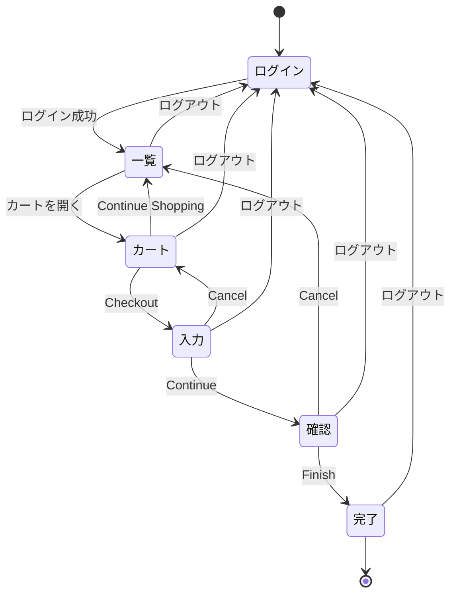

# 購入フローの状態遷移と、テストの対応

購入フロー（一覧 → カート → 入力 → 確認 → 完了）と、戻る・再読み込み・ログアウトの操作で、**どの遷移が、どのテストで確認されているか**をまとめた表です。テストを追加・削除したら、この表も同じ PR で更新してください。

- 対象: SauceDemo（`https://www.saucedemo.com`）
- 記号: ✅ 確認あり ／ ❌ 既知の不具合（`test.fail()` で記録。サイトが直ると失敗して気づける） ／ なし（確認していない）
- テスト ID は、spec の `test(` の先頭の ID（例: `C2`）。ID が無いものは、ファイル名と題名の先頭で示す
- 作成時点: 2026-10-20（`origin/main` の spec を読んで作成）

## 1. 状態遷移図

## 2. 遷移 × テストの対応表

### 2-1. 通常の遷移

| 遷移 | 対応するテスト | 状態 |
| :--- | :--- | :--- |
| 一覧 → カート | `e2e-purchase`（ログインからの通し）、`inventory-cart` の「カート: …削除するとバッジが消える」（カート画面の操作） | ✅ |
| カート → 入力（Checkout） | `e2e-purchase`（通し）。入力画面の項目ごとの欠落は `checkout-validation`（入力画面で止まることを確認） | ✅ |
| カート → 入力（空のカートで Checkout） | `cart-checkout` C1（空のカートで進めないこと） | ❌ 既知の不具合（進めてしまう） |
| 入力 → 確認（Continue） | `checkout-validation`（日本語の全角入力で確認画面へ進む）、`checkout-totals`（金額の表示）、`e2e-purchase` | ✅ |
| 確認 → 完了（Finish） | `e2e-purchase`（注文完了まで）。Finish のエラー（error_user）は `user-types`（既知の不具合） | ✅（error_user は ❌） |
| 入力 → カート（Cancel） | `cart-checkout` C2（カートに戻り、中身が保たれる） | ✅ |
| 確認 → 一覧（Cancel） | `cart-checkout` C3（商品一覧に戻る） | ✅ |
| カート → 一覧（Continue Shopping） | `inventory-cart`「カート: 『Continue Shopping』で商品一覧に戻り、カートの内容が維持される」 | ✅ |
| 完了 → 一覧（Back to Home） | なし | なし |

### 2-2. 操作（戻る・再読み込み・ログアウト）

| 操作 × 状態 | 対応するテスト | 状態 |
| :--- | :--- | :--- |
| 戻る × 完了 → 戻った先のカート | なし（#168 で観点を起票。作業は未実施） | なし |
| 戻る × ログアウト後 → 保護ページ | `protected-pages` S5、`qa-destructive` P7（戻るボタンでも保護される） | ✅ |
| 再読み込み × カート | `cart-checkout` C4（バッジと「Remove」の表示が保たれる）、`inventory-cart`「ページを再読み込みしてもカートの内容が保持される」 | ✅ |
| 再読み込み × 入力・確認 | なし（#152 の判定待ち。仕様の判断が要る） | なし |
| ログアウト × ログイン画面 | `sidebar-logout`「Logout: ログイン画面に戻り、入力欄が空」 | ✅ |
| ログアウト × 別のユーザーのカート | `cart-checkout` C5（前のユーザーのカートが見えない） | ❌ 既知の不具合（見える） |
| 未ログインで直接アクセス（カート・入力・確認） | `checkout-validation`（`/cart.html`・`/checkout-step-one.html`・`/checkout-step-two.html` など。ログイン画面へ戻る） | ✅ |
| 未ログインで直接アクセス（完了） | `qa-destructive` P12（注文完了画面の直リンク） | ✅ |
| Cookie を操作した直接アクセス | `protected-pages` S6・S7（Cookie の削除・改ざん）。S8（Cookie だけで入れる）は既知の不具合 | ✅（S8 は ❌） |

## 3. 更新のしかた

- 遷移やテストを増やしたら、この表と図を同じ PR で更新する
- 既知の不具合（❌）が直ったら、`test.fail()` を外し、この表の記号を ✅ に変える
- 「なし」は、確認していないことを示す。観点の起票（Issue）があるものは、その番号を書く
